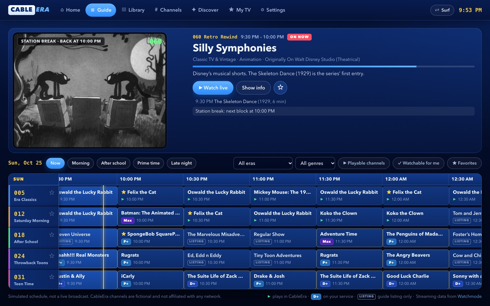
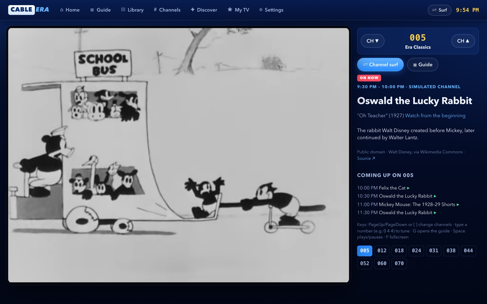
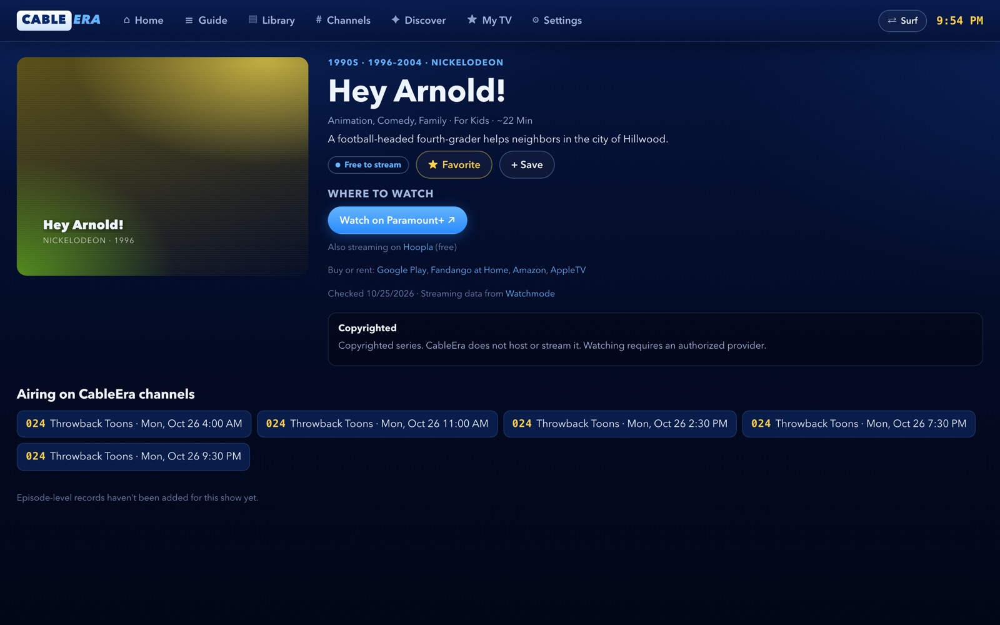
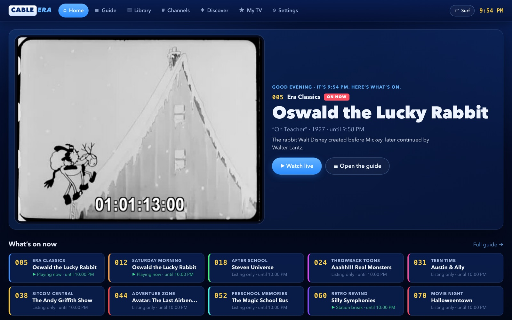
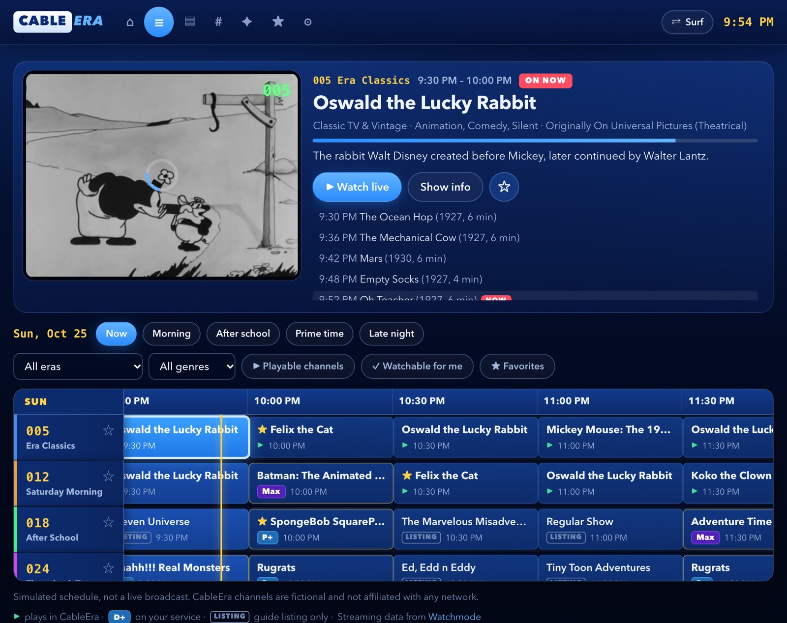
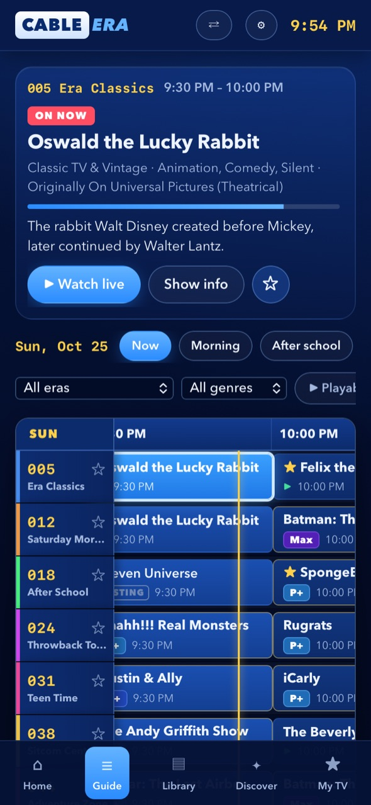
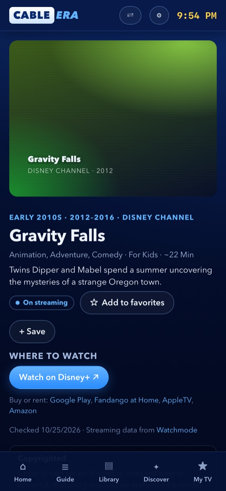

<h1 align="center">
  <br>
  CableEra
</h1>

<p align="center"><em>Your childhood. Your channels. Your TV.</em></p>

<p align="center">
  <a href="https://av1452.github.io/cableera/"><strong>▶ Open the live app</strong></a>
</p>

<p align="center">
  <a href="https://github.com/av1452/cableera/actions/workflows/ci.yml"></a>
  <a href="https://github.com/av1452/cableera/actions/workflows/pages.yml"></a>
  <a href="LICENSE"></a>
  
</p>

<p align="center">
  
</p>

CableEra is a nostalgic, cable-box-style TV app: a blue program guide, numbered channels, live-style schedules, and a library of the shows people grew up with, from 1920s cartoons to early-2010s Disney Channel. It's a responsive PWA tuned for large foldable inner displays, and it works on phones, tablets and desktops.

It's honest about what plays. Public-domain classics and official uploads stream right in the guide. Everything else gets checked, dated links to the streaming services that carry it, with your own services first.

## Highlights

<table>
  <tr>
    <td width="50%"><br><b>Tune in like it's live.</b> Channels run simulated schedules, so you join the episode already in progress, with station breaks, channel up/down, and number-pad tuning.</td>
    <td width="50%"><br><b>Watch on your services.</b> Pick the services you have, and shows on them get a <i>Watch on Paramount+</i>-style button and a badge in the guide.</td>
  </tr>
  <tr>
    <td width="50%"><br><b>What's on now.</b> A TV-style home screen with Continue Watching, programming blocks like After School and Saturday Morning, and recommendations.</td>
    <td width="50%"><br><b>Built for big foldables.</b> The guide, preview and details fit together on large inner displays; 4:3 classics stay 4:3, pillarboxed and never stretched.</td>
  </tr>
</table>

<p align="center">
  
  &nbsp;
  
</p>

## Quick start

```bash
npm install
npm run dev          # http://localhost:5173
npm run build        # type-check + production build into dist/
npm run preview      # serve dist/ at http://localhost:4173
npm run lint
npm test             # end-to-end tests (first run: npx playwright install chromium)
```

Requires Node 22.18+. Want to help? See [CONTRIBUTING.md](CONTRIBUTING.md).

## What's in it

| Section | What it does |
|---|---|
| **Home** | What's on now, Continue Watching, time-of-day programming block, recommendations, featured era |
| **Guide** | Cable-style grid with 10 channels, 36 hours of schedule, a now line, a live preview window, era/genre dimming, playable/favorite filters and arrow-key navigation |
| **Tune** (`#/tune/<channel>`) | Live-style viewing that joins the scheduled episode in progress, with station breaks between shorts, channel up/down, number-pad tuning (type `0 4 4`) and Channel Surf |
| **Watch** (`#/watch/<episode>`) | On-demand player with resume, up-next countdown and marathon queues |
| **Library** | Search, plus filters for era, availability, genre, network and on-air year, with sorting |
| **Channels** | Channel directory with descriptions, current and upcoming programs, and favorites |
| **Discover** | Programming modes (After School, Saturday Morning, Throwback Night, Comfort TV), 14 theme marathons, By Year, a Childhood Timeline and Forgotten Favorites |
| **My TV** | Continue watching, favorites, saved shows, channels, preferred eras and history |
| **Settings** | Theme (classic / midnight / high contrast), scanlines, power-on effect, motion, guide density, landing page, autoplay, captions, storage controls, availability counts and media credits |

### Keyboard

- **Guide:** arrow keys move through the grid, and Enter tunes in or plays. Clicking a cell selects it, and clicking the selected cell tunes in.
- **Tune:** `PageUp`/`PageDown` or `[` `]` change channels, digits tune directly, `G` or `Esc` opens the guide.
- **Player:** `Space`/`K` play and pause, `J`/`L` skip ±10s, `←`/`→` skip ±5s, `F` toggles fullscreen, `M` toggles mute.

## Content and rights

### Availability categories

Each show resolves to one of these (see `availabilityOf` in `src/data/catalog.ts`):

| Category | Meaning | Count today |
|---|---|---|
| Plays in CableEra | At least one episode has a verified media record (public-domain file or official YouTube upload) | 10 series / 56 episodes |
| Free to stream / On streaming | A checked, dated link to a service carrying the show (see below) | Depends on the availability job |
| Public-domain archive | Rights checked, viewable only at the archive | 0 |
| Listing only | Metadata only, with no verified source | The rest |

Listing-only shows never get a Play button. Without a checked link, "Find where to watch" opens a JustWatch search, and a dialog first explains that CableEra hasn't verified availability.

### Streaming links and "My services"

Shows that don't play in CableEra get **Watch on Paramount+**-style buttons that open the exact show on the service (on phones, usually in the service's app). They come from the [Watchmode API](https://api.watchmode.com/):

- `scripts/fetch-availability.mjs` looks each show up by name and year (`scripts/watchmode-overrides.json` fixes wrong matches), then fetches its US sources: subscription, free, buy/rent.
- Viewers pick their services in **Settings → My streaming services** (or My TV). Their services' buttons come first and turn primary, guide cells show a service badge (e.g. `P+`), the guide gets a **Watchable for me** filter, the Library gets **On my services / Streaming anywhere / Free to stream** filters, and Home gets an **On your services** row.
- Every link shows the date it was checked plus "Streaming data from Watchmode" (the free plan requires attribution), and a dialog explains what's needed (subscription, free with ads, purchase) before CableEra opens the service.

**Data handling:** Watchmode's terms don't allow sharing its data with third parties, and cap free-plan caching at 30 days. So `src/data/availability.generated.json` is gitignored and never committed. The deploy workflow fetches it with a secret, keeps it between runs in the Actions cache, and bundles it into the site. Entries older than 30 days are dropped by the script and ignored by the app. A run spends its request budget on never-checked shows first, then the stalest (default 300 requests on the weekly scheduled run, 40 on push deploys). A first full run costs about two requests per show; after that, about one per show per week.

**Setup:** create a free key at [api.watchmode.com](https://api.watchmode.com/), then add it as the repository secret `WATCHMODE_API_KEY` (Settings → Secrets and variables → Actions) and run the "Deploy to GitHub Pages" workflow. Locally: `WATCHMODE_API_KEY=... npm run data:availability`. Without a key, everything still works and shows fall back to the JustWatch search.

### Official YouTube uploads

Some rights holders post full episodes on their own YouTube channels. CableEra plays those through YouTube's embedded player (privacy-enhanced `youtube-nocookie.com` mode), the embedding method YouTube's terms allow, so they work in the guide, live tuning, marathons and on-demand like any other episode.

Safeguards, in `scripts/fetch-youtube-media.mjs`:

- **Allowlist only:** `scripts/youtube-channels.json` lists verified official channels, with how each was confirmed. Uploads from any other channel are rejected, so fan re-uploads can never get in. Today it has one channel: The Official Pokémon YouTube channel (`@pokemon`).
- **Checked every build:** each video goes through YouTube's oEmbed endpoint, which fails for removed, private or embed-disabled videos and reports the uploader. Failures are dropped.
- **Discovery (optional):** with a free YouTube Data API key in the `YOUTUBE_API_KEY` secret, the script lists each allowlisted channel's uploads, matches full-episode titles to shows with the channel's rules, and checks duration, embeddability and US region blocks. Without a key it checks only the hand-curated `scripts/youtube-sources.json` (currently Pokémon episode 1), where durations are entered by hand.
- Like the Watchmode data, `src/data/youtube.generated.json` is regenerated before each build and not committed.

To add a channel, confirm it's the studio's or network's own verified channel, add it with a title rule to `youtube-channels.json`, and note how you confirmed it.

### Playable media

Every playable file is listed in `scripts/commons-sources.json` and resolved by `npm run media:refresh`. For each file, the script:

1. Asks the Wikimedia Commons API for the file's URL, MIME type, dimensions, duration and license tag.
2. Prefers the 480p VP9 transcode, which is small enough for mobile data.
3. Sends a range request to confirm the URL works and supports seeking.
4. Writes `src/data/media.generated.json`. Any file without a public-domain license tag, or with a failing URL, gets `verified: false` and can't play.

Current playable series:

| Series | Rights basis (US) |
|---|---|
| Felix the Cat (1922–1930), Gertie (1914/1921), Koko the Clown (1922/1928), Oswald (1927–1930), Mickey Mouse 1928–29 incl. *Steamboat Willie*, *The Skeleton Dance*, Aesop's Fables *Dinner Time* | Published 1930 or earlier, so the copyright term has expired |
| Fleischer *Superman* (1941–43) | Copyright not renewed, per Wikimedia Commons |
| *The Beverly Hillbillies*, 12 early episodes | Copyright not renewed, per Wikimedia Commons (not every episode of the series) |
| *Pokémon* (official YouTube uploads) | Copyrighted; embedded from the rights holder's official channel, never hosted |

Character names such as Mickey, Felix and Superman can still be trademarks. CableEra uses no studio logos.

**Content note:** some 1920s–40s cartoons contain racial and ethnic caricatures typical of their era. The catalog doesn't flag these yet (see Roadmap).

### Channels

The ten channels (005 Era Classics through 070 Movie Night) are fictional. Their schedules are generated deterministically per channel and day (`src/lib/schedule.ts`), so every reload and every viewer sees the same lineup without a server. The UI labels them as simulated, and they are not live broadcasts.

## Architecture

```
src/
  types.ts                  Show, Episode, MediaSource, ContentRights, Channel, ScheduleEntry, ...
  data/
    shows.ts                Editorial catalog metadata (no media)
    media.generated.json    Verified Commons media records (generated, don't hand-edit)
    *.generated.json        Availability + YouTube data (built in CI, gitignored)
    catalog.ts              Joins shows with media and streaming links; availability; search
    providers.ts            Provider registry, offer grouping, "my services" matching
    channels.ts             Channel identities + editorial collections
  lib/
    schedule.ts             Simulated linear schedule generation
    store.ts                User data behind a UserDataBackend (localStorage today)
    surf.ts                 Channel surf / channel up-down
    router.ts               Hash router (static-host friendly)
  components/               Guide grid, ProgramDetails, Player + YouTubePlayer, shared UI
  pages/                    One file per route
public/                     Manifest, service worker, icons
scripts/                    Commons, Watchmode and YouTube data pipelines
```

These concerns are kept separate: catalog metadata, media/rights, scheduling, playback, UI and user data. Schedules reference catalog IDs and never copy episode data. An `Episode` can exist without a `mediaId`. To add account sync, implement `UserDataBackend` (`load`/`save`) in `src/lib/store.ts`.

### Player

The player uses native `<video>` with `preload="metadata"` and streams through range requests, never downloading whole files. The frame is 4:3 or 16:9 to match the source, and the video uses `object-fit: contain`, so footage is pillarboxed and never stretched. The player checks codec support up front, offers retry on network errors, shows "Tap to play" when the browser blocks autoplay, saves progress every 5 seconds and on pause or exit, and resumes after 10 seconds or more of viewing. Official YouTube uploads use a separate `YouTubePlayer` (YouTube IFrame API) with the same props, so every page plays either kind.

## Hosting

The build is fully static, with a relative `base` and hash routing, so it runs from any path:

- **GitHub Pages:** push to `main` with Pages set to "GitHub Actions". `.github/workflows/pages.yml` lints, refreshes streaming data, builds and deploys. It also runs weekly (Mondays) to keep links fresh.
- Any static host (Netlify, Vercel, S3) also works: serve `dist/`.

The service worker (production only) caches the app shell for offline guide access. It never caches video. API keys (`WATCHMODE_API_KEY`, `YOUTUBE_API_KEY`) live only in GitHub Actions secrets and are used at build time. Never ship them in `VITE_*` variables.

## Testing status

`npm test` runs 19 Playwright tests against the production build on every push and pull request ([CI](.github/workflows/ci.yml)): guide rendering and keyboard navigation, select-then-tune, no Play button on listings, 4:3 playback without stretching, progress save and resume, media-error handling, YouTube player teardown, favorites and services persistence, search, artwork fallbacks, and phone layout. External media is stubbed, so results don't depend on Wikimedia or YouTube.

Manual testing on 2026-10-25 against the production build with Playwright (Chromium and WebKit):

- **Desktop (1440×900):** guide renders 666 cells. Cell selection, arrow-key navigation, the live preview, live tuning (joins in progress), PageUp and number-pad tuning, the 4:3 frame for 4:3 sources and 16:9 for 16:9, progress save and resume after reload, Continue Watching, favorites persisting, search, the playable filter (9 series), no Play button on copyrighted shows, the leaving-CableEra dialog, and no console errors all passed.
- **Foldable sizes (1060×840 landscape, 840×1020 portrait):** no horizontal overflow and no errors.
- **iPhone size, WebKit (393×852):** no overflow on Home, Library or Show pages. The Guide overflowed and was fixed afterwards. WebKit reports WebM as playable, and the player loaded.
- **Blocked autoplay:** falls back to "Tap to play".

- **Streaming features (2026-10-25):** against a mock Watchmode API built from its OpenAPI spec: name+year matching (ThunderCats 2011 vs 1985), retry on 429, request budget, bad or missing key. In the browser: service picker persistence, your service as the primary button, the leaving dialog linking to the exact show, buy/rent and attribution, Library and Home service views, guide badges and the Watchable filter. Official YouTube episode playback worked in the privacy-enhanced embed, in a 16:9 frame. A build with no availability data falls back cleanly. Not yet run against the real Watchmode API (no key yet).

Not yet tested: a real foldable or physical iPhone, PWA installation, or Safari versions older than iOS 17.4 / macOS 14, which can't play WebM. On those, the player shows a "format not supported" message instead of playing.

## Known limitations / roadmap

- **Media hosting:** files are served straight from `upload.wikimedia.org`, which rate-limits heavy use (HTTP 429). That happened during testing. For real traffic, mirror the public-domain files to your own storage or CDN and point `media.generated.json` at them. Add MP4/H.264 versions for older Safari at the same time.
- **Captions:** none of the current files has caption tracks. The `captions` field is wired up for when they're added.
- **Provider links:** appear once `WATCHMODE_API_KEY` is set. Name+year matching can miss shows; check the script's "no confident match" list and add overrides.
- **YouTube coverage:** one allowlisted channel and one curated episode until `YOUTUBE_API_KEY` is set, and networks rotate which episodes are up.
- **Artwork:** only public-domain shows have images (frames from the films). Other shows use generated title cards until licensed artwork or an approved metadata API is added.
- **Content notes:** add per-episode advisories for dated stereotypes in vintage cartoons.
- **Episodes:** episode-level records exist only for the playable series.
- **Popularity sorting:** no popularity data yet.
